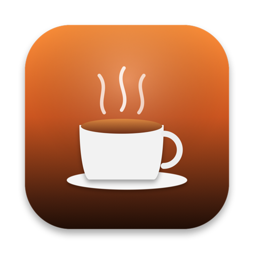

<p align="center">
  
</p>

<h1 align="center">☕️ Doppio</h1>

<p align="center">
  <b>Modern, lightweight, and battery-conscious keep-awake utility for macOS.</b>
</p>

<p align="center">
  <a href="README.md"><b>English</b></a> •
  <a href="README.ru.md">Русский</a>
</p>

<p align="center">
  <a href="https://github.com/banzaez/doppio/releases/latest"></a>
  
  
  
  
  
</p>

---

## 📖 Overview

**Doppio** is an open-source macOS menu bar application designed to prevent your Mac from sleeping during critical tasks — including long code compilations, machine learning training runs, high-resolution renders, live presentations, webinars, and large file transfers.

Unlike legacy utilities that poll system state or run heavy background runloops, Doppio is engineered from scratch for modern macOS versions (Sonoma & Sequoia). It leverages **Swift 6 Strict Concurrency**, actor-isolated **IOKit Power Assertions**, **event-driven hardware observation**, and an adaptive monotonic countdown clock that consumes **0% idle CPU**.

---

## 📑 Table of Contents

- [Why Doppio?](#-why-doppio)
- [Key Features](#-key-features)
  - [Native Menu & Liquid Glass Aesthetics](#-native-menu--liquid-glass-aesthetics)
  - [Calibrated Settings Window (`⌘,`)](#-calibrated-settings-window-)
  - [Headless Toggle & Fast Access](#-headless-toggle--fast-access)
  - [Notch-Optimized Display Modes](#-notch-optimized-display-modes)
  - [Intelligent Automation Triggers](#-intelligent-automation-triggers)
  - [Hardware-Aware Power Management & Battery Protection](#-hardware-aware-power-management--battery-protection)
  - [Integrated GitHub Releases Updater](#-integrated-github-releases-updater)
  - [Full Internationalization (i18n)](#-full-internationalization-i18n)
- [Architecture & Engineering Standards](#-architecture--engineering-standards)
- [Comparison with Alternatives](#-comparison-with-alternatives)
- [Installation & Getting Started](#-installation--getting-started)
- [Diagnostics & Verification](#-diagnostics--verification)
- [Project Structure](#-project-structure)
- [Keyboard Shortcuts](#-keyboard-shortcuts)
- [License](#-license)

---

## 💡 Why Doppio?

| Requirement | Traditional Tools (Amphetamine / Caffeine) | `caffeinate` CLI | **Doppio** |
|:---|:---:|:---:|:---:|
| **Modern Concurrency** | Legacy Runloops / Locks | N/A | **Swift 6 Actor Isolation & Sendable** |
| **Idle CPU Usage** | Periodic timer polling (~0.5–2% CPU) | Low | **True Zero-Idle (Adaptive 1s → 60s)** |
| **Power Source Hook** | Periodic polling | None | **Event-Driven `CFRunLoopSource` (IOKit)** |
| **MacBook Notch Fit** | Fixed wide text badge | None | **Icon-Only & Full Countdown Modes** |
| **Monotonic Clock** | Vulnerable to NTP / time shifts | Wall clock | **`ContinuousClock` (Immune to time shifts)** |
| **Process Triggers** | Complex, multi-layered settings | Manual PID flag | **1-Click running app picker + auto-release** |
| **Battery Guard** | Basic or none | None | **Configurable cutoff (10–30%)** |
| **Apple Design Alignment**| Outdated Aqua / Big Sur UI | None | **Native Liquid Glass & SF Symbols** |

---

## ✨ Key Features

### 🪟 Native Menu & Liquid Glass Aesthetics
- **macOS System-Native Menus**: Built with `NSMenu` and `MenuBarExtra`, respecting Apple Human Interface Guidelines with standard 6pt corner radii and subtle glass materials.
- **Monochrome Apple SF Symbols**: Automatically adapts vibrancy and contrast across Light Mode, Dark Mode, and dynamic accent colors.
- **Visual Feedback**: Real-time checkmarks (`✓`) indicating active presets, quick session extension menus, and tactile stepper controls.

### ⚙️ Calibrated Settings Window (`⌘,`)
- **Fixed-Geometry Canvas (`360 × 355 pt`)**: Optimized to fit the largest section without content clipping, unwanted scrollbars, or distracting resize jumps.
- **Native macOS Titlebar**: Integrated window controls (traffic lights) with smooth spring-animated tab switching.
- **Three Focused Preference Tabs**:
  1. **General**: Interface language, launch at login via `SMAppService`, menu bar display style, low battery safety threshold, and expiration warnings.
  2. **Automation**: App triggers, AC power plug-in rules, external monitor detection, and sleep-on-disconnect toggles.
  3. **About**: Release channel status, update verification, and repository information.

### ⚡️ Headless Toggle & Fast Access
- **Dual-Action Menu Item**: Standard left or right click opens the interactive menu.
- **`⌥-Click` (Option-Click) Headless Toggle**: Option-click the menu bar icon to toggle keep-awake on and off instantly without displaying popovers or opening menus.

### 📱 Notch-Optimized Display Modes
- **Full Mode**: Displays the coffee cup symbol alongside the active countdown (`☕️ 45m`).
- **Minimalist Mode**: Displays only the icon (`☕️`) to preserve valuable horizontal space on 14" and 16" MacBook Pro screens with a camera notch.

### 🤖 Intelligent Automation Triggers
- **Process Automation (App Triggers)**: Keeps your Mac awake while resource-intensive apps (e.g., Xcode, Final Cut Pro, Blender, DaVinci Resolve, Zoom) are open, automatically releasing sleep assertions when the app terminates.
- **Active Process Picker**: Select running applications directly from a pre-filtered list with cached app icons, or browse any `.app` bundle from disk.
- **AC Power Detection**: Automatically activates keep-awake when plugged into a charger and deactivates upon switching to battery.
- **External Display Detection**: Maintains wakefulness whenever an external monitor or projector is connected (including Clamshell mode support).
- **Instant System Wake Sync**: Observes `NSWorkspace.didWakeNotification` to immediately re-validate timers and power assertions upon opening your laptop lid.

### 🛡 Hardware-Aware Power Management & Battery Protection
- **Low-Battery Safety Cutoff**: Automatically disables sleep prevention when the battery drops below your defined threshold (10% to 30%), ensuring you never arrive at a meeting with an empty battery.
- **Real-Time Battery Telemetry**: Shows active power source status (AC Power, Battery, or Charging) without polling.
- **Two Distinct Sleep Modes**:
  - **Display & System**: Inhibits both display dimming and system sleep (`kIOPMAssertionTypePreventUserIdleDisplaySleep`). Ideal for reading, presentations, and remote screen sharing.
  - **System Only**: Allows the display to switch off normally while keeping processors, network sockets, servers, and background renders alive (`kIOPMAssertionTypePreventUserIdleSystemSleep`).

### 🔄 Integrated GitHub Releases Updater
- Direct, lightweight integration with the GitHub Releases API (`banzaez/doppio`).
- Interactive update alerts featuring release notes, SemVer validation, and one-click direct downloads.
- Optional automated daily background checks.

### 🌐 Full Internationalization (i18n)
- Built-in localization for **6 languages**: English, Ukrainian (`Українська`), Russian (`Русский`), German (`Deutsch`), French (`Français`), and Spanish (`Español`).
- Automatic locale detection (`Locale.preferredLanguages`) on first launch with manual override in settings.
- Grammatically accurate pluralization engine across all supported language families.

---

## 🏛 Architecture & Engineering Standards

Doppio was developed under strict Apple platform conventions and Swift 6 design principles:

```
┌────────────────────────────────────────────────────────┐
│                      DoppioApp                         │
│   (@main, MenuBarExtra, LSUIElement = true, Accessory) │
└──────────────────────────┬─────────────────────────────┘
                           │
             ┌─────────────▼─────────────┐
             │       DoppioState         │
             │   (@Observable MainActor) │
             └──────┬─────────────┬──────┘
                    │             │
        ┌───────────▼──┐       ┌──▼────────────────────────┐
        │ SleepActor   │       │ Background Services       │
        │ Swift Actor  │       │ - SmartTriggerService     │
        │ IOKit PM     │       │ - BatteryMonitorService   │
        └──────────────┘       │ - AppUpdateService        │
                               │ - SessionTimerController  │
                               └───────────────────────────┘
```

1. **Strict Concurrency & Actor Isolation**:
   - `SleepAssertionService` is encapsulated in a dedicated **Swift Actor**, providing compile-time thread safety for `IOPMAssertionID` lifecycles and eliminating race conditions.
   - Clean `@Sendable` boundaries ensure zero data races under the Swift 6 compiler.
2. **Observation Framework**:
   - `DoppioState` uses the modern `@Observable` macro on `@MainActor`, eliminating the overhead of legacy `Combine` publishers.
3. **Continuous Monotonic Time**:
   - `SessionTimerController` is driven by Apple's `ContinuousClock`. Timing calculations remain accurate regardless of system clock adjustments, NTP updates, or daylight saving transitions.
4. **Adaptive Sleep Intervals (Zero-Idle CPU)**:
   - When the user interface is visible, the timer ticks at 1.0s intervals for smooth progress rings.
   - When running in the background, the timer sleeps until the exact moment of the next minute boundary or the 60-second expiration alert, reducing idle CPU usage to zero.
5. **Event-Driven Power Monitoring**:
   - `BatteryMonitorService` registers a `CFRunLoopSource` using `IOPSNotificationCreateRunLoopSource` on the main runloop, avoiding recurring timer checks.
6. **Native System Autostart**:
   - Employs `SMAppService.mainApp`, Apple's modern Launch-at-Login standard that requires no external helper binaries.

---

## 🚀 Installation & Getting Started

### System Requirements
- **macOS 14.0 (Sonoma)** or **macOS 15+ (Sequoia)**.
- Compatible with Apple Silicon (M1/M2/M3/M4) and Intel architectures (Universal).

### Prebuilt Binary
1. Download the latest `Doppio.zip` from [GitHub Releases](https://github.com/banzaez/doppio/releases/latest).
2. Unzip and drag `Doppio.app` to your `/Applications` folder.
3. Launch Doppio. It will appear directly in your menu bar.

### Building from Source
Ensure Xcode 15.3+ or Swift 6.0+ is installed:

```bash
# Clone the repository
git clone https://github.com/banzaez/doppio.git
cd doppio

# Build and package the release application
./build_app.sh

# Launch the newly built app
open Doppio.app
```

### Running Tests
Execute the comprehensive test suite powered by the modern Swift `Testing` framework:

```bash
swift test
```

---

## 🔍 Diagnostics & Verification

You can verify that Doppio is actively preventing sleep directly from the macOS Terminal using Apple's power management diagnostics tool:

```bash
pmset -g assertions
```

When Doppio is active, you will see an entry similar to:

```text
   PreventUserIdleDisplaySleep named: "Doppio Keep-Awake Session"
   PreventUserIdleSystemSleep  named: "Doppio Keep-Awake Session"
```

---

## 📂 Project Structure

```text
doppio/
├── Assets/
│   └── AppIcon.png                 # Application logo (256x256 PNG)
├── AppIcon.icns                    # Multi-resolution macOS icon bundle
├── build_app.sh                    # Release packager and ad-hoc code signer
├── Package.swift                   # Swift Package Manager manifest (Swift 6.4)
├── README.md                       # English documentation
├── README.ru.md                    # Russian documentation
├── Sources/
│   └── Doppio/
│       ├── DoppioApp.swift         # Entry point (@main, MenuBarExtra, LSUIElement)
│       ├── Localization/
│       │   ├── AppLanguage.swift   # Supported languages & auto-detection
│       │   └── L10n.swift          # Localized strings dictionary with pluralization
│       ├── Models/
│       │   ├── BatteryInfo.swift   # Power state & charging telemetry
│       │   ├── DeactivationReason.swift # Structured session termination reasons
│       │   ├── KeepAwakePreset.swift    # Preset duration definitions
│       │   ├── MenuBarDisplayStyle.swift# Standard vs Minimalist notch display
│       │   ├── SessionTriggerSource.swift# Trigger origins (Manual, AC, App, Display)
│       │   ├── SleepAssertionType.swift # Display+System vs System-Only assertion modes
│       │   └── TriggerApp.swift    # Target process automation entity
│       ├── Services/
│       │   ├── AppNotificationService.swift # Interactive user notifications
│       │   ├── AppUpdateService.swift       # GitHub Releases update checker
│       │   ├── BatteryMonitorService.swift  # Event-driven IOKit battery listener
│       │   ├── LaunchAtLoginService.swift   # SMAppService login item manager
│       │   ├── QuickClickMonitor.swift      # Option-click (⌥) and secondary click interceptor
│       │   ├── SleepAssertionService.swift  # Swift Actor managing IOKit sleep assertions
│       │   └── SmartTriggerService.swift    # Structured Concurrency process & monitor watchers
│       ├── State/
│       │   ├── DoppioSettingsStore.swift    # UserDefaults persistence layer
│       │   ├── DoppioState.swift            # Observable coordinator managing state & business logic
│       │   └── SessionTimerController.swift # ContinuousClock monotonic countdown controller
│       └── Views/
│           ├── Components/
│           │   ├── ControlCenterHeroCard.swift  # Status card with progress ring
│           │   ├── FooterActionsView.swift      # Bottom toolbar & battery indicator
│           │   ├── GlassStyles.swift            # Liquid Glass visual modifiers
│           │   ├── ModelPresentation.swift      # Presentation helpers & formatters
│           │   ├── PresetSelectionView.swift    # Preset grid & custom duration stepper
│           │   ├── SettingsWindowManager.swift  # Settings window geometry & delegate controller
│           │   ├── SleepModeSelectorView.swift  # Animated sleep mode selector
│           │   └── WindowAutoResizer.swift      # Dynamic height constraint helper
│           ├── DoppioMenuView.swift         # Native NSMenu layout
│           ├── DoppioPopoverView.swift      # Popover UI interface
│           ├── MenuBarLabelView.swift       # Status bar item view
│           └── SettingsView.swift           # 3-tab preferences window
└── Tests/
    └── DoppioTests/
        └── DoppioTests.swift       # Swift Testing suite (21 unit & integration tests)
```

---

## ⌨️ Keyboard Shortcuts

| Shortcut | Action |
|:---|:---|
| `⌥ + Click` on Menu Bar Icon | Instantly toggle keep-awake without opening the menu |
| `⌘ + ,` | Open Settings window |
| `⌘ + Q` | Quit Doppio |

---

## 📄 License

Doppio is free and open-source software distributed under the [MIT License](https://opensource.org/licenses/MIT).
