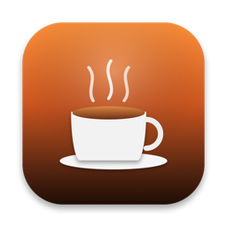

<p align="center">
  
</p>

# Doppio

<p align="center">
  <b>Современная, эстетичная и энергоэффективная утилита для строки меню macOS, предотвращающая засыпание Mac.</b>
</p>

<p align="center">
  <a href="README.md">English</a> •
  <a href="README.ru.md"><b>Русский</b></a>
</p>

<p align="center">
  <a href="https://github.com/banzaez/doppio/releases/latest"></a>
  
  
  
  
  
</p>

---

## 📖 Обзор

**Doppio** — это утилита с открытым исходным кодом для строки меню macOS, предотвращающая переход Mac в спящий режим во время выполнения ответственных задач: компиляции кода, обучения нейросетей, рендеринга видео, проведения вебинаров, презентаций и длительной передачи файлов.

В отличие от устаревших утилит, опрашивающих систему через таймеры, Doppio спроектирован с нуля под современные версии macOS (Sonoma и Sequoia). Он опирается на **Swift 6 Strict Concurrency**, актор-изолированное управление утверждениями **IOKit Power Assertions**, **событийный мониторинг оборудования** и монотонный таймер с **нулевой нагрузкой на процессор в фоновом режиме (Zero-Idle CPU)**.

---

## 📑 Содержание

- [Почему Doppio?](#-почему-doppio)
- [Ключевые возможности](#-ключевые-возможности)
  - [Нативное системное меню и Liquid Glass](#-нативное-системное-меню-и-liquid-glass)
  - [Калиброванное окно настроек (`⌘,`)](#-калиброванное-окно-настроек-)
  - [Быстрый Headless-переключатель](#-быстрый-headless-переключатель)
  - [Компактный режим для экранов с вырезом (Notch)](#-компактный-режим-для-экранов-с-вырезом-notch)
  - [Умные триггеры автоматизации](#-умные-триггеры-автоматизации)
  - [Умная защита батареи и управление питанием](#-умная-защита-батареи-и-управление-питанием)
  - [Встроенная система обновлений через GitHub Releases](#-встроенная-система-обновлений-через-github-releases)
  - [Полная мультиязычность (i18n)](#-полная-мультиязычность-i18n)
- [Архитектура и стандарты разработки](#-архитектура-и-стандарты-разработки)
- [Сравнение с аналогами](#-сравнение-с-аналогами)
- [Установка и запуск](#-установка-и-запуск)
- [Диагностика и проверка](#-диагностика-и-проверка)
- [Структура проекта](#-структура-проекта)
- [Горячие клавиши](#-горячие-клавиши)
- [Лицензия](#-лицензия)

---

## 💡 Почему Doppio?

| Параметр | Традиционные утилиты (Amphetamine / Caffeine) | `caffeinate` в терминале | **Doppio** |
|:---|:---:|:---:|:---:|
| **Современный стек** | Устаревшие RunLoop / блокировки | Нет | **Swift 6 Strict Concurrency, Swift Actor, Sendable** |
| **Нагрузка на CPU в покое** | Постоянный поллинг таймеров (~0.5–2% CPU) | Низкая | **Zero-Idle CPU (адаптивный шаг 1с → 60с)** |
| **Слушатель питания** | Опрос по интервалу | Нет | **Событийный `CFRunLoopSource` (IOKit)** |
| **Вырез MacBook Notch** | Только длинная текстовая плашка | Нет | **Режим только иконки и режим с обратным отсчётом** |
| **Монотонные часы** | Зависимы от скачков NTP и времени системы | Системные часы | **`ContinuousClock` (не зависит от изменений времени)** |
| **Триггеры приложений** | Сложные перегруженные меню | Ручной PID | **Выбор активного приложения в 1 клик с кэшем иконок** |
| **Защита аккумулятора** | Базовая или отсутствует | Нет | **Настраиваемая отсечка (10–30%)** |
| **Интерфейс macOS** | Устаревший стиль Aqua / Big Sur | Нет | **Нативный Liquid Glass, SF Symbols** |

---

## ✨ Ключевые возможности

### 🪟 Нативное системное меню и Liquid Glass
- **Системное меню (`NSMenu`)**: Лаконичный интерфейс в строгом соответствии с Apple Human Interface Guidelines со стандартным радиусом углов (6 pt) и нативным стеклом Liquid Glass.
- **Монохромные SF Symbols**: Автоматическая адаптация контраста и насыщенности в светлой, тёмной теме и при любых акцентных цветах macOS.
- **Быстрый отклик**: Моментальная активация пресетов с системной галочкой (`✓`), подменю продления сессии и тактильный степпер.

### ⚙️ Калиброванное окно настроек (`⌘,`)
- **Фиксированная геометрия (`360 × 355 pt`)**: Размер окна откалиброван под самый объёмный раздел — интерфейс не прыгает, не перерисовывается рывками и не содержит лишних скроллбаров.
- **Интеграция с заголовком macOS**: Нативный светофор управления окном и плавная spring-анимация переключения вкладок.
- **3 логические вкладки**:
  1. **Основные**: Язык, автозапуск `SMAppService`, стиль отображения в строке меню, порог отключения при разряде батареи и уведомления.
  2. **Автоматизация**: Триггеры приложений, реакция на адаптер питания AC, обнаружение внешнего дисплея и автоматическое отключение.
  3. **О Doppio**: Статус версии, проверка обновлений на GitHub и ссылки на проект.

### ⚡️ Быстрый Headless-переключатель
- **Двойной клик**: Левый или правый клик по иконке открывает меню программы.
- **`⌥-Клик` (Option-Click)**: Клик с зажатой клавишей Option мгновенно включает или выключает режим бодрствования без открытия меню или поповера.

### 📱 Компактный режим для экранов с вырезом (Notch)
- **Стандартный режим**: Иконка чашки и точный обратный отсчёт (`☕️ 45м`).
- **Минималистичный режим**: Только чашка (`☕️`) для экономии места на экранах MacBook Pro 14" и 16" с вырезом камеры.

### 🤖 Умные триггеры автоматизации
- **Привязка к приложениям**: Автоматический запуск бодрствования при старте ресурсоёмких программ (Xcode, Blender, Final Cut Pro, DaVinci Resolve, Zoom) и снятие блокировки сна при их закрытии.
- **Выбор в 1 клик**: Интерактивный список активных пользовательских процессов с кэшированием иконок, либо выбор любого файла `.app` через диалог Finder.
- **Питание от сети (AC)**: Автоматическая активация при подключении блока питания и снятие при переходе на батарею.
- **Внешний дисплей**: Удержание системы активной при наличии внешнего монитора или проектора (включая режим закрытой крышки Clamshell).
- **Синхронизация при пробуждении**: Мгновенный пересчёт таймеров и ассершенов при открытии крышки ноутбука через `NSWorkspace.didWakeNotification`.

### 🛡 Умная защита батареи и управление питанием
- **Защита от глубокого разряда**: Автоматическое снятие блокировки сна при падении заряда ниже порога (от 10% до 30%), чтобы ноутбук не сел в дороге.
- **Мониторинг питания без поллинга**: Индикация источника питания (Сеть, Батарея, Идёт зарядка).
- **Два режима бодрствования**:
  - **Экран и система**: Дисплей не гаснет, блокировка не включается (`kIOPMAssertionTypePreventUserIdleDisplaySleep`). Идеально для презентаций, чтения и вебинаров.
  - **Только система**: Экран гаснет для экономии энергии, но процессор, фоновые компиляции, сетевые загрузки и серверы продолжают работу (`kIOPMAssertionTypePreventUserIdleSystemSleep`).

### 🔄 Встроенная система обновлений через GitHub Releases
- Прямая работа с API релизов GitHub (`banzaez/doppio`).
- Интерактивные системные алерты со списком изменений (Release Notes) и прямым переходом к загрузке.
- Опциональная автоматическая фоновая проверка раз в сутки.

### 🌐 Полная мультиязычность (i18n)
- Поддержка **6 языков**: Украинский, Русский, Английский, Немецкий, Французский и Испанский.
- Автоматическое определение языка системы (`Locale.preferredLanguages`) при первом старте.
- Собственный движок плюрализации с учётом грамматики каждого языкового семейства.

---

## 🏛 Архитектура и стандарты разработки

Doppio разработан строго в соответствии с современными стандартами платформы Apple:

```
┌────────────────────────────────────────────────────────┐
│                      DoppioApp                         │
│   (@main, MenuBarExtra, LSUIElement = true, Accessory) │
└──────────────────────────┬─────────────────────────────┘
                           │
             ┌─────────────▼─────────────┐
             │       DoppioState         │
             │   (@Observable MainActor) │
             └──────┬─────────────┬──────┘
                    │             │
        ┌───────────▼──┐       ┌──▼────────────────────────┐
        │ SleepActor   │       │ Фоновые сервисы           │
        │ Swift Actor  │       │ - SmartTriggerService     │
        │ IOKit PM     │       │ - BatteryMonitorService   │
        └──────────────┘       │ - AppUpdateService        │
                               │ - SessionTimerController  │
                               └───────────────────────────┘
```

1. **Swift 6 Strict Concurrency**:
   - `SleepAssertionService` изолирован в **Swift Actor** — потокобезопасное управление дескрипторами `IOPMAssertionID` без состояний гонки.
   - Соответствие протоколу `Sendable` исключает утечки и взаимные блокировки данных.
2. **Фреймворк Observation**:
   - Главное состояние `DoppioState` построено на макросе `@Observable` на `@MainActor` без накладных расходов `Combine`.
3. **Монотонный таймер ContinuousClock**:
   - `SessionTimerController` работает на `ContinuousClock`, сохраняя непрерывность и точность отсчёта вне зависимости от ручной смены времени или синхронизации NTP.
4. **Адаптивный цикл Zero-Idle CPU**:
   - 1.0 с при открытом окне приложения для плавной анимации прогресс-бара.
   - Спящий режим до границы следующей минуты в строке меню или за 60 секунд до уведомления, снижая фоновую нагрузку на CPU до 0%.
5. **Событийный IOKit без поллинга**:
   - `BatteryMonitorService` подключает `CFRunLoopSource` (`IOPSNotificationCreateRunLoopSource`) к главному циклу без холостых таймеров.
6. **Нативный автозапуск**:
   - Использование `SMAppService.mainApp` без устаревших вспомогательных демонов.

---

## 🚀 Установка и запуск

### Системные требования
- **macOS 14.0 (Sonoma)** или **macOS 15+ (Sequoia)**.
- Совместимость с Apple Silicon (M1/M2/M3/M4) и Intel (Universal бинарник).

### Готовый бандл
1. Скачайте свежий архив `Doppio.zip` из [GitHub Releases](https://github.com/banzaez/doppio/releases/latest).
2. Распакуйте и перенесите `Doppio.app` в папку `/Applications`.
3. Запустите приложение — оно появится в строке меню.

### Сборка из исходников
Для сборки требуется Xcode 15.3+ или Swift 6.0+:

```bash
# Клонирование репозитория
git clone https://github.com/banzaez/doppio.git
cd doppio

# Сборка и подпись релизного приложения
./build_app.sh

# Запуск собранного приложения
open Doppio.app
```

### Запуск тестов
```bash
swift test
```

---

## 🔍 Диагностика и проверка

Вы можете проверить состояние блокировок сна непосредственно через терминал macOS с помощью штатной утилиты:

```bash
pmset -g assertions
```

При активном Doppio в выводе появятся строки:

```text
   PreventUserIdleDisplaySleep named: "Doppio Keep-Awake Session"
   PreventUserIdleSystemSleep  named: "Doppio Keep-Awake Session"
```

---

## 📂 Структура проекта

```text
doppio/
├── Assets/
│   └── AppIcon.png                 # Логотип приложения (256x256 PNG)
├── AppIcon.icns                    # Набор иконок macOS в формате icns
├── build_app.sh                    # Скрипт сборки релиза и ad-hoc подписи
├── Package.swift                   # Манифест Swift Package Manager (Swift 6.4)
├── README.md                       # Английская документация
├── README.ru.md                    # Русская документация
├── Sources/
│   └── Doppio/
│       ├── DoppioApp.swift         # Точка входа (@main, MenuBarExtra, LSUIElement)
│       ├── Localization/
│       │   ├── AppLanguage.swift   # Поддерживаемые языки и автоопределение
│       │   └── L10n.swift          # Мультиязычный словарь с плюрализацией
│       ├── Models/
│       │   ├── BatteryInfo.swift   # Модель батареи и источника питания
│       │   ├── DeactivationReason.swift # Причины остановки сессии
│       │   ├── KeepAwakePreset.swift    # Конфигурация пресетов времени
│       │   ├── MenuBarDisplayStyle.swift# Стили строки меню (компактный / полный)
│       │   ├── SessionTriggerSource.swift# Источники запуска (вручную, AC, программа, дисплей)
│       │   ├── SleepAssertionType.swift # Режимы утверждений (Экран+Система / Система)
│       │   └── TriggerApp.swift    # Модель целевого приложения автоматизации
│       ├── Services/
│       │   ├── AppNotificationService.swift # Интерактивные системные уведомления
│       │   ├── AppUpdateService.swift       # Проверка релизов GitHub Releases
│       │   ├── BatteryMonitorService.swift  # Событийный IOKit мониторинг питания
│       │   ├── LaunchAtLoginService.swift   # Автозапуск через SMAppService
│       │   ├── QuickClickMonitor.swift      # Перехват Option-клика (⌥) и правого клика
│       │   ├── SleepAssertionService.swift  # Swift Actor над IOKit Power Assertions
│       │   └── SmartTriggerService.swift    # Триггеры процессов и экранов на Structured Concurrency
│       ├── State/
│       │   ├── DoppioSettingsStore.swift    # Персистентное хранилище настроек UserDefaults
│       │   ├── DoppioState.swift            # Главный @Observable координатор состояния
│       │   └── SessionTimerController.swift # Монотонный таймер на ContinuousClock
│       └── Views/
│           ├── Components/
│           │   ├── ControlCenterHeroCard.swift  # Карточка статуса с кольцом прогресса
│           │   ├── FooterActionsView.swift      # Нижняя панель и индикатор батареи
│           │   ├── GlassStyles.swift            # Модификаторы стиля Liquid Glass
│           │   ├── ModelPresentation.swift      # Презентационные расширения моделей
│           │   ├── PresetSelectionView.swift    # Сетка пресетов и степпер времени
│           │   ├── SettingsWindowManager.swift  # Управление окном настроек и делегат
│           │   ├── SleepModeSelectorView.swift  # Анимированный селектор режима сна
│           │   └── WindowAutoResizer.swift      # Помощник адаптивной высоты окна
│           ├── DoppioMenuView.swift         # Разметка системного меню NSMenu
│           ├── DoppioPopoverView.swift      # Всплывающий поповер
│           ├── MenuBarLabelView.swift       # Иконка и бейдж в строке меню
│           └── SettingsView.swift           # Окно настроек из 3 вкладок
└── Tests/
    └── DoppioTests/
        └── DoppioTests.swift       # Набор из 21 юнит- и интеграционного теста
```

---

## ⌨️ Горячие клавиши

| Сочетание | Действие |
|:---|:---|
| `⌥ + Клик` по иконке в строке меню | Мгновенно включить/выключить бодрствование без открытия меню |
| `⌘ + ,` | Открыть окно настроек |
| `⌘ + Q` | Завершить Doppio |

---

## 📄 Лицензия

Doppio распространяется под свободной лицензией [MIT](https://opensource.org/licenses/MIT).
